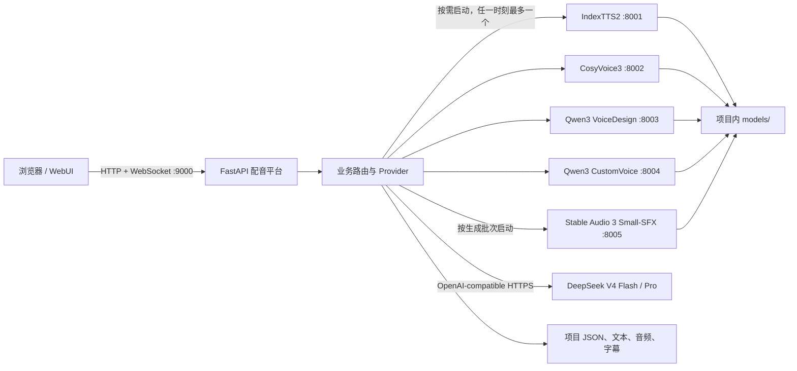

# 配音平台架构说明

本文描述当前仓库中用于生产配音的平台架构。它以当前代码为准，而不是上游 IndexTTS2 演示项目或早期 MVP 文档。运维步骤见 [operations.md](operations.md)；历史恢复与规划材料仅保存在 [`archive/`](../archive/README.md) 供维护审计。

## 1. 系统边界

系统由一个业务平台进程、共享 GPU 租约上的本地 TTS/SFX 工作进程、一个外部 LLM 服务以及文件系统数据目录组成。



关键约束：

- 平台端口固定为 `9000`；本地 TTS 默认端口为 `8001`～`8004`，SFX worker 为 `8005`。
- TTS 与 SFX 共用生成音频 GPU 租约。SFX 批次前卸载 TTS/Whisper，批次后卸载 SFX 并恢复 TTS，避免多个大模型同时占用显存。
- WebUI 打开时只查询状态，不自动启动 TTS。模型加载由用户在平台配置页明确触发。
- `DUBBING_*_BASE_URL` 或 `dubbing_service/config.json` 可以把 Provider 指向外部服务；平台托管的本地工作进程仍按后端注册表中的端口启动。
- `start_platform.bat` 默认让平台监听 `127.0.0.1:9000`。只有显式传入 `--lan` 才监听 `0.0.0.0:9000`；此模式只能用于受信任 LAN，并应通过 Windows 防火墙限制来源。跨不受信任网络必须增加 TLS、反向代理和独立鉴权层。

## 2. 代码分层

| 层 | 位置 | 职责 |
| --- | --- | --- |
| 应用入口 | `dubbing_service/app/main.py` | FastAPI 生命周期、路由挂载、静态 WebUI、健康检查、退出时清理 TTS 子进程 |
| 路由 | `dubbing_service/app/routers/` | 项目、角色、分段、合成、音效计划/任务、制作发布、字幕、设置、LLM 配置和 WebSocket 批处理 |
| Provider | `dubbing_service/app/providers/` | 把业务对象转换为四种 TTS、Stable Audio 或 OpenAI-compatible LLM 请求 |
| 存储 | `dubbing_service/app/storage/` | 文件系统 JSON、锁、原子写入和自动分段事务 |
| 数据模型 | `dubbing_service/app/models/` | Pydantic 项目、角色、分段、字幕模型和枚举 |
| 后端注册表 | `dubbing_service/app/core/tts_backends.py` | 后端 ID、能力、端口、脚本、模型目录和解释器边界的单一事实来源 |
| WebUI | `dubbing_service/webui/` | Vue 页面、波形编辑、批量任务和平台设置；浏览器依赖固定在 `webui/vendor/` |
| 工作进程 | `service/*.py` | IndexTTS2、CosyVoice3、Qwen3 VD/CV、Stable Audio 的本地 REST 进程；属于内部推理层而非业务入口 |
| 引擎源码 | `indextts/`、`cosyvoice/` | 上游/派生推理实现；CosyVoice 按 vendored source 管理，修改时必须同时复核对应许可证 |

所有平台业务 API 使用 `/api/v1` 前缀；轻量就绪探针是 `/api/v1/ready`，聚合健康信息是 `/api/v1/health`。

## 3. 四个 TTS 后端

| 后端 ID | 显示名称 | 端口 | uv 环境 | 项目内模型目录 | 主要能力 | 角色要求 |
| --- | --- | ---: | --- | --- | --- | --- |
| `indextts` | IndexTTS2 | 8001 | 根 `.venv` | `models/index_tts` | 零样本音色克隆、8 维情感、情感文本 | 必须有参考音频或音色库绑定 |
| `cosyvoice3` | CosyVoice3 | 8002 | `environments/cosyvoice/.venv` | `models/cosyvoice3/Fun-CosyVoice3-0.5B` | 零样本音色克隆、自然语言指令、语速 | 必须有参考音频或音色库绑定 |
| `qwen3tts` | Qwen3-TTS VoiceDesign | 8003 | `environments/qwen3tts/.venv` | `models/qwen3_tts/Qwen3-TTS-VoiceDesign` | 用文本描述设计音色、语言和表演指令 | 不需要参考音频；角色应有稳定的音色描述 |
| `qwen3tts_cv` | Qwen3-TTS CustomVoice | 8004 | `environments/qwen3tts/.venv` | `models/qwen3_tts/Qwen3-TTS-CustomVoice` | 内置 speaker、语言和情感指令 | 不需要参考音频；角色应选 speaker |

后端选择优先级为：

1. 分段 `tts_backend`；
2. 角色 `tts_backend`；
3. 全局 `tts_backend`；
4. 无效或缺失时安全回退为 `indextts`。

角色语音配置是稳定默认值，分段字段是一次性覆盖：

- VoiceDesign：角色 `voice_description`（为空时使用角色描述）定义身份；角色 `style_instruction` 和分段 `emotion_text` 追加为表演要求，不会替换身份。
- CustomVoice：`segment.qwen3_speaker` > `role.qwen3_speaker` > `vivian`；语言同样按分段、角色、全局默认顺序解析。
- CosyVoice3：分段情感文本优先于角色风格指令。
- IndexTTS2：使用角色参考音频和分段情感模式/向量/文本。

Stable Audio 不是第五个 TTS 后端：它只生成单个 SFX/Ambience 素材，由上层 SoundPlan 决定语义位置，再进入现有四轨混音。

## 4. 四个隔离的 uv 环境

仓库不是一个“把所有生成音频依赖混在一起”的环境，也不是 uv workspace。四个独立 lockfile/解释器边界如下：

| 环境 | Python | 锁文件 | 用途 |
| --- | --- | --- | --- |
| `.venv` | 3.12.13 | 根 `uv.lock` | 平台、IndexTTS2、字幕、测试和维护脚本 |
| `environments/qwen3tts/.venv` | 3.12.13 | `environments/qwen3tts/uv.lock` | Qwen VoiceDesign 与 CustomVoice 共享运行时 |
| `environments/cosyvoice/.venv` | 3.10.19 | `environments/cosyvoice/uv.lock` | CosyVoice3 的兼容依赖栈 |
| `environments/stableaudio/.venv` | 3.11.13 | `environments/stableaudio/uv.lock` | Stable Audio 3 Small-SFX CUDA Worker |

只使用 `scripts/bootstrap.ps1` 创建或修复环境。正常启动直接调用已创建的解释器，不隐式执行 `uv sync`。旧的 `.venv_qwen3tts` 已删除，后端注册表也已移除兼容回退；任一隔离环境缺失时必须明确失败。

隔离的原因不是目录美观，而是存在不可兼容的核心依赖组合，例如不同 Python、PyTorch、Transformers、Pydantic 和 WeText 版本。将四者重新合并会破坏可复现性。

## 5. 配置边界

配置优先级为：环境变量 > `dubbing_service/config.json` > 代码默认值。

主要环境变量：

- `DUBBING_TTS_BASE_URL`
- `DUBBING_COSYVOICE_BASE_URL`
- `DUBBING_QWEN3_TTS_BASE_URL`
- `DUBBING_QWEN3_TTS_CV_BASE_URL`
- `DUBBING_TTS_API_KEY`
- `DUBBING_LLM_BASE_URL`
- `DUBBING_LLM_API_KEY`
- `DUBBING_PROJECTS_ROOT`

`dubbing_service/config.json`、`dubbing_service/llm_providers.json` 和根 `.env` 都是本机私密状态，不属于源码。HTTP 响应与工作进程日志始终遮蔽 API Key；旧的 `DUBBING_EXPOSE_SECRETS` 逃生开关已失效，不能通过环境变量解除遮蔽。

## 6. 主要业务流程

### 6.1 启动

1. `start_platform.bat` 设置项目内模型缓存和离线变量。
2. `platform_doctor.py --startup` 在服务启动前检查环境、模型清单、JSON、FFmpeg 和端口。
3. `tools/platform_launcher.py` 用根 `.venv` 启动 9000 平台并等待 `/api/v1/ready`。
4. 用户在 WebUI 选择 TTS 后端并启动；平台根据后端注册表选择解释器、脚本和模型路径。
5. 工作进程健康检查通过后才返回“已启动”。

### 6.2 LLM 自动分段

默认 DeepSeek 流程为：

1. 选择 `deepseek-v4-flash`，使用 JSON 输出模式并关闭 thinking。
2. Provider 对网络错误、429 和 5xx 做有界重试；认证/参数类 4xx 不重试。
3. 平台校验 JSON 结构、非空段落以及分段文本对原文的完整覆盖。
4. Flash 在可回退错误下仍失败时，最多调用一次 `deepseek-v4-pro`；Pro 不形成回退循环。
5. 验证通过后，原文、分段和新增角色一起提交；验证失败不会覆盖现有项目数据。

DeepSeek 是外部云服务，不属于本地离线模型供应链。API Key 只能保存在环境变量或本机忽略文件中。

### 6.3 合成

1. 平台按“分段 > 角色 > 全局”解析后端和角色配置。
2. REST 与 WebSocket 批处理先取得同一个进程级 TTS/GPU 租约；跨项目第二批立即返回冲突，租约存续期间禁止切换/停止工作进程。
3. Provider 请求对应工作进程；长同步 HTTP/GPU 端点在线程池执行，使健康接口在推理期间仍能响应。
4. 每段先持久化 `GENERATING`，完成后立即持久化 `DONE/FAILED`；落盘失败会返回 durability failure，不能向前端误报成功。
5. 返回音频被复制/提升到项目 `audio/segments/`；A/B 版本使用独立文件名。
6. 导出前 WebUI 会先刷新波形编辑草稿，避免导出旧状态。

### 6.4 导出与字幕

FFmpeg/ffprobe 负责裁剪、静音、变速、拼接和媒体探测；字幕由 faster-whisper 生成，结果与 SRT 采用原子写入。生成物属于项目数据，不属于源码或模型供应链。

### 6.5 音效生成与四轨制作

1. 现有 LLM 只接收句段 ID、文本、角色、情绪与相邻上下文，起草独立 `SoundPlan`；句段事务不被改写。
2. 操作者编辑英文 prompt、语义锚点和混音参数并批准 cue；每个 cue 默认生成两个不可变候选。
3. 持久任务取得共享 GPU 租约，平台托管带实例 token 的 loopback 8005 worker；断开浏览器不取消任务。
4. 只有人工采用的候选才原子提升为 `AudioAsset` 和语义锚定 `TimelineClip`；解除采用执行补偿事务。
5. Preview、Master 与 Release 使用同一个锚点解析和四轨渲染入口。对白 Take、变速或交叉淡化变化后按最新时间轴重定位；文本变化令 cue stale。
6. Master/Release 冻结文件 SHA、模型/代码 revision、prompt、seed、许可快照与当前正式质检；缺失或过期时 fail closed。

## 7. 文件数据与事务

默认项目根目录是 `dubbing_projects/`，可通过 `DUBBING_PROJECTS_ROOT` 指向独立数据盘。每个项目是一个独立目录：

```text
<projects_root>/<project_id>/
├── project.json
├── segments.json
├── text/
├── roles/prompts/
├── audio/segments/
├── audio/chapters/
├── audio/final/
├── production/sound_generation/{plans,jobs,candidates}/
├── production/assets/{sfx,ambience}/
├── subtitles/
└── logs/
```

一致性策略：

- `project.json`、`segments.json`、字幕、配置和全局列表采用“同目录临时文件 + flush/fsync（适用处）+ `os.replace`”写入，避免半截 JSON。
- 项目元数据和分段有独立的进程内锁；涉及两者时固定按“项目元数据锁，再分段锁”的顺序获取。
- 自动分段对 `project.json`、`segments.json` 和 `text/raw.txt` 先全部 staging，再保留同目录备份并逐个提升；任何提升失败会倒序恢复已替换文件。
- 自动分段完成后才清理旧音频；清理失败最多留下孤儿文件，不会让新元数据指向已删除文件。
- 手工 JSON 导入和角色删除会把 `project.json`/`segments.json` 作为一个带回滚的事务提交；分段更新、合并、删除、情感音频和角色参考音频均先提交新元数据，再回收旧文件。
- 正在合成的项目不能删除；项目更新的 load→modify→save 全程持有元数据锁。

事务边界必须正确理解：

- 文件系统不能原生原子替换多个路径，当前实现是带回滚的应用层事务，不等同于数据库 WAL。
- 锁只保护同一 Python 进程。禁止两个平台进程同时写同一个 `DUBBING_PROJECTS_ROOT`。
- 崩溃、磁盘损坏和误删除仍依赖外部冷备份；不能用原子写入代替备份。

## 8. 模型供应链

模型权重只放在项目 `models/`，Git 只跟踪 `models/README.md` 与 `models/manifests/*.json`。每个 manifest 固定源、revision、文件大小和 SHA256。

恢复顺序：

1. 已在项目内且通过大小/SHA256 的目标文件；
2. manifest 中列出的项目内恢复 blob；
3. 只有显式传入对应联网开关时，才从 manifest 固定的 ModelScope 或门控 Hugging Face model/revision/file 下载；Hugging Face token 只从进程环境读取；
4. 下载到 staging/cache，校验后原子提升；坏目标进入 `models/.quarantine/`，不直接删除。

运行时设置 `HF_HUB_OFFLINE=1`、`TRANSFORMERS_OFFLINE=1`，不允许启动时隐式联网。Stable Audio 只在显式供应阶段访问门控 Hugging Face 源，并要求有效许可回执；运行时从校验后的本地 config/checkpoint/T5Gemma 目录加载。IndexTTS2 的 BigVGAN 固定到经过大小与 SHA256 核对的 ModelScope 文件 revision；项目内 recovery blob 仅是可选缓存，不是新机恢复前置条件。

## 9. 源码、模型与许可证边界

本仓库不是一份统一的宽松许可证作品：

- `LICENSES/Bilibili-IndexTTS.txt` / `LICENSES/Bilibili-IndexTTS-ZH.txt` 是 bilibili IndexTTS2 自定义模型使用许可，覆盖范围、商用阈值、下游义务和用途限制必须按协议原文审查；中英文出现差异时协议声明以中文为准。
- IndexTTS2 manifest 中的 MaskGCT 辅助权重标记为 `CC-BY-NC-4.0`，默认含非商业限制；用于商业生产前必须取得适当授权或完成替换与技术验证。
- `cosyvoice/` 主要源码为 Apache-2.0，但其 `third_party/` 和模型仍需逐项保留并遵守各自声明。
- Qwen3-TTS 与 CosyVoice3 模型在当前 manifest 中记录为 Apache-2.0；正式发布前仍应以取得模型时的上游 revision 和随附许可证为准。
- Stable Audio 3 权重适用 Stability AI Community/Enterprise License，T5Gemma 另受 Gemma 条款约束；模型、条款哈希或许可层级变化会使正式流程重新确认或阻断。
- WebUI 内置的 Vue、WaveSurfer 和 Tailwind 文件分别保留各自 MIT LICENSE 和版本哈希。
- 自研平台代码没有单独声明一个可以覆盖所有上游组件的统一再许可。不得把“可查看源码”直接等同于“整个发行物可自由商用或再分发”。

`scripts/export_source.ps1` 只导出显式白名单文本/源码并扫描常见密钥格式；它永不导出模型权重、虚拟环境、API 配置、项目、声音、日志或生成音频。源码导出也不授予任何新增许可权。

## 10. 架构维护规则

- 新增 TTS 后端先更新 `core/tts_backends.py`，再实现 Provider、服务脚本、manifest、环境锁和契约测试；不要在路由中另建一套端口映射。
- 修改依赖必须在对应 uv 项目更新 lockfile，并单独运行该环境的 `uv pip check`。
- 修改模型文件必须更新 manifest 并完成全 SHA256 验证；不得只看目录存在。
- 修改项目多文件写流程时必须保持锁顺序，并增加失败注入/回滚测试。
- 新增私密或运行时路径时，同时更新 `.gitignore`、备份说明和源码导出白名单/拒绝规则。
- 生产发布必须从一个明确 commit/tag 构建；工作区中未跟踪的模型、数据和密钥不能进入源码包。
